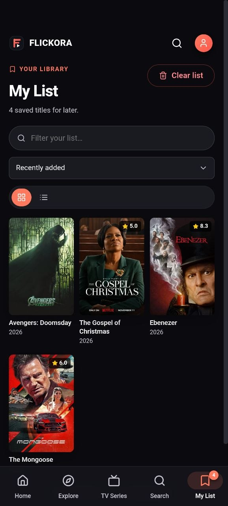
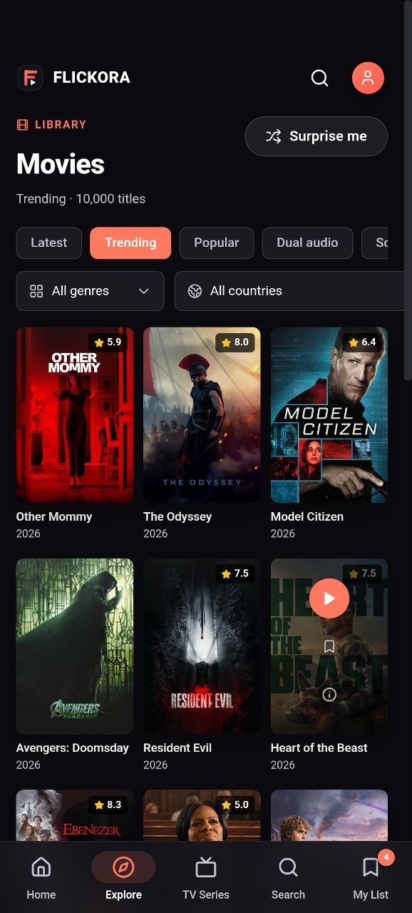
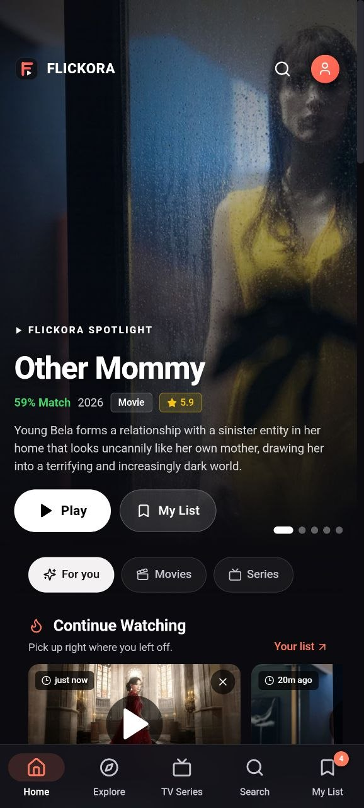
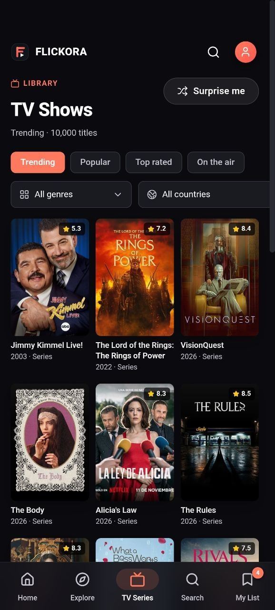

<div align="center">


# Flickora Mobile

**A beautiful, fast Android streaming client for discovering movies and TV series.**  
Built with React, TypeScript, and Capacitor — powered by TMDB metadata and the VidRift player.

[](https://github.com/BindasTime/Flickora-Mobile/releases/latest)
[](https://github.com/BindasTime/Flickora-Mobile/releases/latest)
[](https://react.dev)
[](https://typescriptlang.org)
[](LICENSE)

</div>

---

## 📱 Screenshots

<div align="center">
<table>
<tr>
<td align="center"><br /><sub><b>Home</b></sub></td>
<td align="center"><br /><sub><b>Browse Movies</b></sub></td>
<td align="center"><br /><sub><b>TV Shows</b></sub></td>
<td align="center"><br /><sub><b>My List</b></sub></td>
</tr>
</table>
</div>

---

## ✨ Features

| Feature | Description |
|---|---|
| 🎬 **Editorial Home** | Rotating hero banner, trending titles, and curated rows for movies and series |
| 🔍 **Instant Search** | Search across both libraries with 400ms debounce and media-type filter |
| 🌍 **Country Discovery** | Filter movies and series by origin country, alongside genre filters |
| 🔊 **Dual Audio** | Discover movies with non-original audio tracks (Hindi, etc.) |
| ❤️ **My List** | Save any title locally — sort, filter, grid/list view toggle |
| ▶️ **Continue Watching** | The player tracks real progress so you can resume any episode |
| 📺 **Season Browser** | Browse seasons, read episode synopses, and track your progress |
| 🏆 **Top 10 Today** | Trending movies chart updated daily from TMDB |
| 📡 **Offline-first Cache** | Metadata cached on disk and served stale when network drops |
| 🔒 **Private by Design** | No account, no telemetry — your list and progress never leave the device |
| 🌑 **Immersive Mode** | Full-screen experience with Android immersive mode support |

---

## 🚀 Quick Install

Download the latest APK directly from [GitHub Releases](https://github.com/BindasTime/Flickora-Mobile/releases/latest):

1. Download `Flickora-v1.2.0.apk`
2. On your Android device go to **Settings → Install unknown apps** and allow your browser
3. Open the downloaded file and tap **Install**

> **Requires Android 7.0 (API 24) or higher**

---

## 🛠️ Build from Source

### Prerequisites

| Tool | Version |
|---|---|
| Node.js | ≥ 18 |
| Java JDK | 17 (required by Gradle) |
| Android SDK | API 35 (compileSdk) |
| Android Studio | Hedgehog or later (optional, for SDK tools) |

### Setup

```bash
# 1. Clone the repo
git clone https://github.com/BindasTime/Flickora-Mobile.git
cd Flickora-Mobile

# 2. Install dependencies
npm install

# 3. Build the web bundle and sync to Android
npm run build
npx cap sync android
```

### Build the APK

```bash
# Debug build (sideload-ready)
npm run build:apk

# Release build (unsigned — sign before distributing)
npm run build:apk:release
```

The compiled APK will be output to `release/Flickora-v1.2.0.apk`.

### Development Server

```bash
npm run dev
```

Then use **Live Reload** with Capacitor by pointing your device to your local IP via `capacitor.config.ts`.

---

## 🏗️ Tech Stack

```
Flickora Mobile
├── Frontend         React 19 + TypeScript 5.7
├── Build Tool       Vite 6
├── Android Bridge   Capacitor 8
├── Routing          React Router 7
├── Icons            Lucide React
├── Data             TMDB REST API v3
└── Playback         VidRift embed player
```

---

## 📂 Project Structure

```
├── src/
│   ├── components/      # Reusable UI (Hero, MediaCard, MediaRow, BottomNav …)
│   ├── pages/           # Route-level screens (Home, Browse, Search, Player …)
│   ├── lib/             # TMDB client, Capacitor bridge, hooks, types
│   ├── state/           # Global AppState (wishlist, progress, toasts)
│   └── styles/          # Global CSS + mobile-specific overrides
├── android/             # Capacitor Android project
├── Screenshots/         # App screenshots
└── release/             # Built APK artifacts
```

---

## 🔑 API & Playback

Flickora uses the [TMDB API](https://www.themoviedb.org/documentation/api) for all catalogue
metadata, posters, and backdrops. Playback is provided by the
[VidRift](https://vidrift.net/) embed player loaded inside a sandboxed WebView.

> This app does not host, store, or distribute video. It is a personal-use client only.

---

## ⚙️ Configuration

The TMDB API key is embedded in the client bundle at build time via `src/lib/tmdb.ts`.  
If you fork this project, replace the key with your own from [themoviedb.org](https://www.themoviedb.org/settings/api).

---

## 📄 License

MIT © [BindasTime](https://github.com/BindasTime)

---

<div align="center">
  <sub>Metadata &amp; artwork by <a href="https://www.themoviedb.org/">TMDB</a> · Playback by <a href="https://vidrift.net/">VidRift</a> · Not affiliated with either.</sub>
</div>
